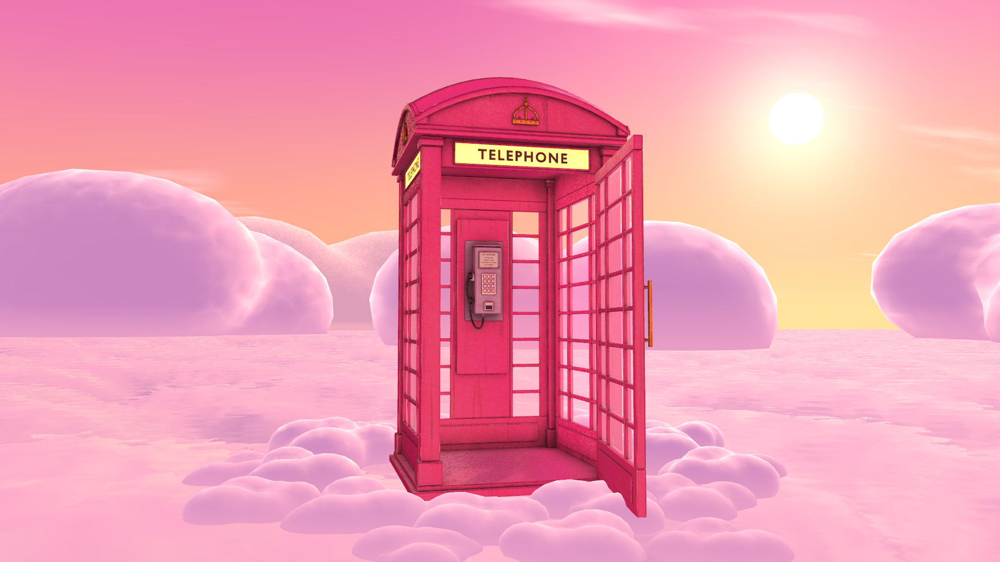
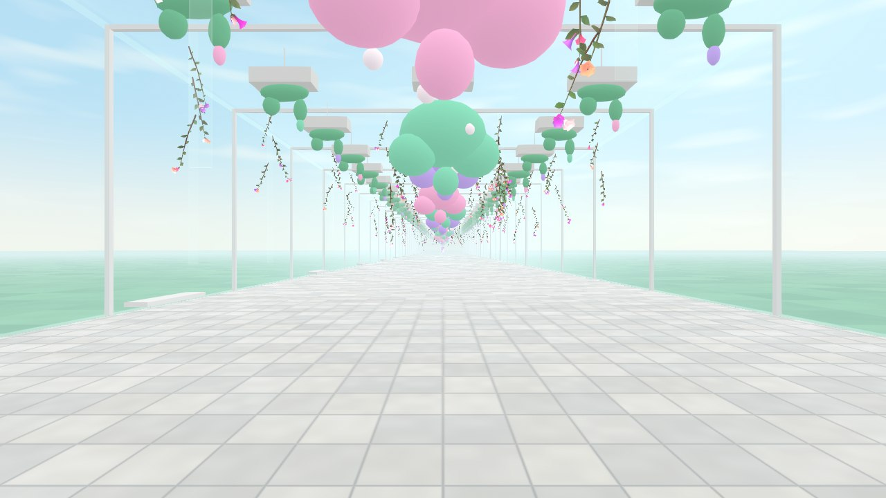
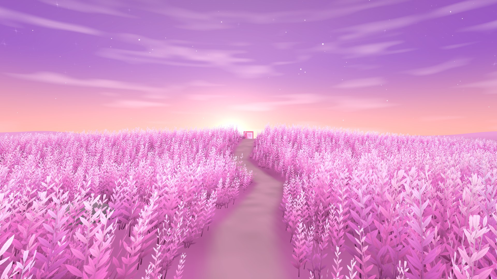
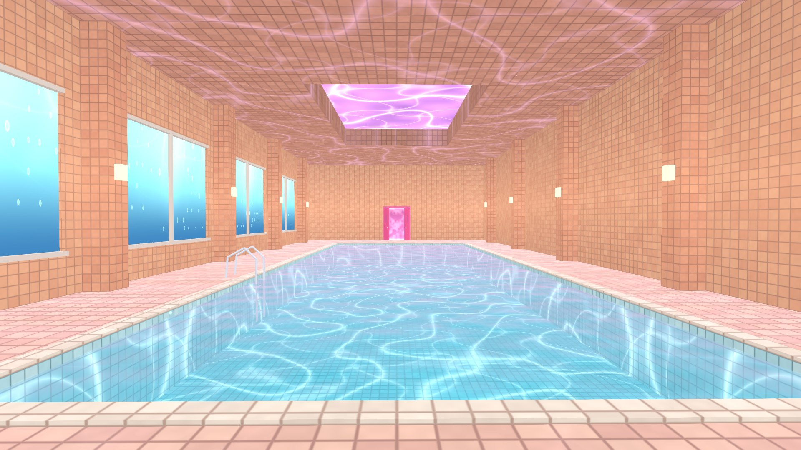

# Liminal Doors

A VRChat world of doors that open onto quiet in-between places: an empty pool after closing, a laundrette with a sky
turning in one washer, a platform between trains. Behind every door hides one little glass animal. Hatching now: the
first door opens on Astra's pink phone booth, alone above a sea of pink clouds. PC VR / desktop.

The world's caretaker pet is **Door Dormouse** (pet program #82, The Threshold). The floor plan, concept book and idea
inbox were drafted by Codex on 2026-10-15/16.

## Fresh start (2026-10-18)

This project starts from VRChat Creator Companion's **World template** (VRChat SDK 3.10.5, Unity 2022.3.22f1). From
Astra's Infinite Pole it takes only the **phone booth's shape** (six meshes in `Assets/LiminalDoors/Booth/Meshes`), and
that booth is being changed: for now it wears plain materials. An earlier version that copied much more of Infinite
Pole is kept on the branch `claude/stop-01-pink-booth-20261018`.

## Doorspaces

Each place behind a door is a **Doorspace**. All of them live in one scene, `Assets/LiminalDoors/Scenes/Liminal Doors.unity`,
each as its own root in the Hierarchy named `Doorspace NN · Place Animal`, 3 km apart.

**Getting around in the editor:** *LiminalDoors > Doorspaces > Window* (Ctrl+Shift+D) lists every Doorspace. *Go* flies the
Scene view to where you arrive and puts that Doorspace's sky up; *Door* flies to its forward door; *Solo* hides the others
in the Scene view only; *Show all* brings them back. Ctrl+Shift+] and Ctrl+Shift+[ step to the next and previous one.

| # | Doorspace | Status |
|---|---|---|
| 01 | Pinkscape Fox | The handmade K6 booth with the spawn inside, standing in pink clouds all the way round; all clouds, no grass (2026-10-20). The glass fox to come |
| 02 | Faraway Field Hare | A 300 m path through tall pink frond grass that sways and parts as you walk, a sparkling dusk sky. The glass hare to come |
| 03 | Pool After Closing Axolotl | A 220 m tiled pool hall: caustics, underwater windows, a violet skylight, the pink double door. The glass axolotl to come |
| 04 | Last Laundrette Raccoon | First pass (2026-10-19), from its concept. The glass raccoon to come |
| 05 | Apricot Underpass Gecko | First pass (2026-10-19), from its concept. The glass gecko to come |
| 06 | Platform Between Trains Crane | First pass (2026-10-19), from its concept. The glass crane to come |
| 07 | Velvet Waiting Room Moth | First pass (2026-10-19), from its concept. The glass moth to come |
| 08 | Rain That Misses You Frog | First pass (2026-10-19), from its concept. The glass frog to come |
| 09 | Upside-Down Conservatory Hummingbird | First pass (2026-10-19), from its concept. The glass hummingbird to come |
| 10 | Salt Moon Ibex | First pass (2026-10-19), from its concept. The glass ibex to come |
| 11 | Motel Without Rooms Cat | First pass (2026-10-19), from its concept. The glass cat to come |
| 12 | Tidal Carpet Manta Ray | First pass (2026-10-19), from its concept. The glass manta ray to come |
| 13 | Vending Machine Clearing Hedgehog | First pass (2026-10-19), from its concept. The glass hedgehog to come |
| 14 | Lavender Quarry Lynx | First pass (2026-10-19), from its concept. The glass lynx to come |
| 15 | Empty Aquarium Seahorse | First pass (2026-10-19), from its concept. The glass seahorse to come |
| 16 | Blackwater Footbridge Heron | First pass (2026-10-19), from its concept. The glass heron to come |
| 17 | Soft Staircase Dragonfly | First pass (2026-10-19), from its concept. The glass dragonfly to come |
| 18 | Snow in the Lobby Snow Leopard | First pass (2026-10-19), from its concept. The glass snow leopard to come |
| 19 | Pearl Car Park Raven | First pass (2026-10-19), from its concept. The glass raven to come |
| 20 | Room Beneath the Ocean Octopus | First pass (2026-10-19), from its concept. The glass octopus to come |
| 21 | Wind Telephone Deer | First pass (2026-10-19), from its concept. The glass deer to come |
| 22 | Sleeping Arcade Firefly | First pass (2026-10-19), from its concept. The glass firefly to come |
| 23 | Low-Gravity Court Kangaroo | First pass (2026-10-19), from its concept. The glass kangaroo to come |
| 24 | Ribbon Dunes Scarab | First pass (2026-10-19), from its concept. The glass scarab to come |
| 25 | Frosted Office Praying Mantis | First pass (2026-10-19), from its concept. The glass praying mantis to come |
| 26 | Red Sun Reservoir Flamingo | First pass (2026-10-19), from its concept. The glass flamingo to come |
| 27 | Room of Curtains Jellyfish | First pass (2026-10-19), from its concept. The glass jellyfish to come |
| 28 | Glass Orchard Butterfly | First pass (2026-10-19), from its concept. The glass butterfly to come |
| 29 | Midnight Food Court Red Panda | First pass (2026-10-19), from its concept. The glass red panda to come |
| 30 | Door at Sunrise Swan | First pass (2026-10-19), from its concept. The glass swan to come |
| 31 | Steam Between Stars Otter | First pass (2026-10-19), from its concept. The glass otter to come |
| 32 | Sunset Sandbar Sandpiper | First pass (2026-10-19), from its concept. The glass sandpiper to come |
| 33 | Aquaglass Concourse Dolphin | First pass (2026-10-19), from its concept. The glass dolphin to come |
| 36 | Blue-Sky Terminal Kingfisher | First pass (2026-10-19), from its concept. The glass kingfisher to come |

Floors 34, 35 and 37 were taken out after the originality check (`docs/originality-check-20261019.md`).
**LiminalDoors > World > Build all** rebuilds stops 02 and 03 and the Doorspaces 04-36 and wires every door;
*LiminalDoors > Doorspaces > Build Doorspaces 04-36* rebuilds only those. Renders are in `docs/renders/`.

All 31 new Doorspaces at a glance (arrival, halfway, the door): `docs/renders/doorspaces-20261019/`.

## Working in it

- The VRChat SDK packages are unpacked into `Packages/` from Creator Companion's cache and aren't committed. Open the
  project in VCC or Unity 2022.3.22f1 to restore them.
- Menu **LiminalDoors > Stop 01**: *Build* rebuilds the stop (existing materials are kept), *Render* writes
  `Review/stop-01-render/`, *Open* frames the booth door. **LiminalDoors > Desktop test** runs the SDK's Build & Test (no upload).
- Agents drive an open editor through `Review/agent-queue/*.cmd` (`status`, `refresh`, `save`, `menu LiminalDoors/...`,
  `desktop-test`) instead of relaunching Unity.
- Uploads, releases and `main` change only with Astra's OK.
