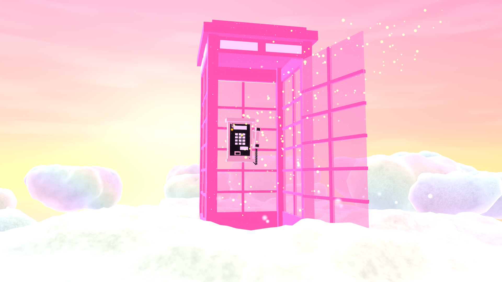

# Liminal Doors

Astra's VRChat world of doors (PC). Each door leads to a stop: a quiet, empty place with one hidden glass animal.
The world's caretaker pet is **Door Dormouse** (pet program #82, The Threshold). The floor plan, concept book and
idea inbox were drafted by Codex on 2026-10-15/16; this Unity project starts the playable world.

## Stops built

| # | Animal | Stop | Scene | Status |
|---|---|---|---|---|
| 01 | Fox | Pink Booth | `Assets/LiminalDoors/Scenes/01 Fox - Pink Booth.unity` | Scene and renders. No door travel, phone, fox or walkable mound yet |

Stop 01 is the exact pink booth from Astra's Infinite Pole, on its own cloud mound above Infinite Pole's pink cloud sea,
under the same sunset sky and Pinkscape bloom. Those assets are copied from Infinite Pole with their original GUIDs
(`Assets/Astra/...`); the booth and sea prefabs were extracted from `AstrasInfinitePole.unity` with
`Tools/infinite-pole-export/extract_prefab.py` (read only). New here: the gold door drift, the fox hiding spot and the VRChat spawn.

## Working in it

- Unity 2022.3.22f1, VRChat Worlds SDK 3.10.5 (embedded in `Packages/`, not committed), linear colour, post-processing v2.
- Menu **LiminalDoors > Stop 01**: *Build scene* rewrites the stop from the prefabs, *Render review shots* writes
  `Review/stop-01-render/`, *Open scene* opens it framed on the door.
- Agents drive an open editor through `Review/agent-queue/*.cmd` (`status`, `refresh`, `save`, `menu LiminalDoors/...`),
  the same as in Infinite Pole. Never relaunch or batchmode Unity while the project is open.
- Uploads, releases and `main` change only with Astra's OK.

## Tools born here

- [`Tools/world-spawn-tool`](Tools/world-spawn-tool/world-spawn-tool-20261018.md): spawns Astra's next VRChat world.
  First the public repo and the Findastra profile link, then the Unity project skeleton. It's a Unity Unicorn tool
  and moves to [findastra/unity-unicorn](https://github.com/findastra/unity-unicorn) once it has enough in it.
- [`Tools/infinite-pole-export`](Tools/infinite-pole-export): copy assets from Astra's Infinite Pole with their GUIDs,
  and turn a scene subtree into a prefab (read only on the source project).
